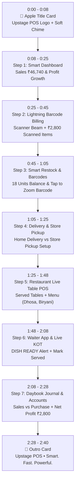

#  Apple Support Style Explanation Video Guide — Upstage POS

> **Reference Inspiration**: [Apple Support Explainer Videos (Clean, Minimalist, Device-Focused)](https://youtu.be/ZZgDFjqxAb0?si=1I8o1zVVb4XYhrdh)  
> **App Name**: **Upstage POS** ([`Upstagekadai`](file:///Users/upstage_1/Desktop/Upstagekadai))  
> **Official Assets**: Uses your exact real app screenshots from [`/video_assets/`](file:///Users/upstage_1/Desktop/Upstagekadai/video_assets/) and authentic app logo.  
> **Interactive Video Player**: [`Upstage_POS_Apple_Style_Video.html`](file:///Users/upstage_1/Desktop/Upstagekadai/Upstage_POS_Apple_Style_Video.html)  

---

## 🎬 Video Anatomy & Style Guidelines (Apple Aesthetic)



---

## 📋 Second-by-Second Production Choreography

### 1. Title Screen (0:00 – 0:08)
* **Background**: Clean Apple dark slate (`#0B0C10`) with a subtle ambient radial glow.
* **Visual**: Your official logo (`00_logo.png`) scales in smoothly with a gentle bounce.
* **On-Screen Typography**:
  ```text
  Upstage POS
  How to manage your Retail Shop or Restaurant with Upstage POS
  ```
* **Audio**: Subtle Apple chime chord + gentle ambient lo-fi synth chord.
* **Voiceover**:
  > *"வணக்கம்! உங்கள் கடையை அல்லது உணவகத்தை மிக எளிதாக நிர்வகிக்க Upstage POS செயலியை எப்படி பயன்படுத்துவது என்று இந்த வீடியோவில் பார்க்கலாம்."*

---

### 2. Step 1: The Smart Dashboard & Profit Growth (0:08 – 0:25)
* **Visual Screen**: [`01_dashboard.png`](file:///Users/upstage_1/Desktop/Upstagekadai/video_assets/01_dashboard.png) inside the centered iPhone hardware mockup.
* **Animation**:
  - Animated pulsing circle taps on the **Total Profit (+18.6%)** green growth curve.
  - Subtitle card slides in on the left:
    `Step 1: Monitor Sales & Live Profit`
* **On-Screen Highlights**:
  - Total Sales: **₹46,740.00**
  - Net Profit: **₹11,825.00**
  - 1-Tap Toggle between Retail & Restaurant
* **Voiceover**:
  > *"ஆப்பை திறந்ததும் தோன்றும் இந்த டேஷ்போர்டில் இன்றைய விற்பனை, இந்த மாத விற்பனை மற்றும் 18.6% அதிகரித்த நிகர லாபத்தை நேரடி கிராஃப் மூலம் மிகத் தெளிவாக அறியலாம்."*

---

### 3. Step 2: Lightning-Fast Barcode Billing (0:25 – 0:45)
* **Visual Screen**: [`03_barcode_scanner.png`](file:///Users/upstage_1/Desktop/Upstagekadai/video_assets/03_barcode_scanner.png)
* **Animation**:
  - A glowing emerald laser beam sweeps down the camera scanner viewfinder.
  - The cart items (Hooded t-shirt ₹760, Jeans ₹1140, Track pant ₹900) automatically tally up to **₹2,800**.
  - Animated tap pulses firmly on the **"Review Order"** button.
* **Subtitle Card**:
  `Step 2: Instant Barcode & Camera Billing`
* **Voiceover**:
  > *"பில்லிங் செய்யும்போது தாமதமே வேண்டாம்! கேமரா அல்லது புளூடூத் ஸ்கேனர் மூலமாக துணிகள் மற்றும் மளிகைப் பொருட்களை நொடிகளில் ஸ்கேன் செய்து, உடனே 'Review Order' கொடுத்து பில் போட்டுவிடலாம்!"*

---

### 4. Step 3: Smart Restock & Barcode Zoom/Print (0:45 – 1:05)
* **Visual Screen**: [`06_restock_inventory.png`](file:///Users/upstage_1/Desktop/Upstagekadai/video_assets/06_restock_inventory.png)
* **Animation**:
  - Highlights the **18 L** stock badge on Hooded T-Shirt.
  - Animated pointer taps on the scannable barcode label (`Tap to Zoom & Print`).
  - Restock, Expire, and Delete action buttons highlight.
* **Subtitle Card**:
  `Step 3: Restock Products & Print Barcodes`
* **Voiceover**:
  > *"சரக்கு இருப்பை கண்காணிக்க 'RESTOCK' பகுதிக்கு செல்லுங்கள். ஒவ்வொரு பொருளின் ஸ்டாக் அளவை அறிந்து கொள்ளலாம். திரையிலேயே பார்கோடை பெரிதாக்கி பிரிண்ட் செய்யலாம்; புதிய சரக்கு வந்தால் ஒரே கிளிக்கில் ரீ-ஸ்டாக் செய்துகொள்ளலாம்!"*

---

### 5. Step 4: Door Delivery & Pickup Flexibility (1:05 – 1:25)
* **Visual Screen**: [`08_delivery_pickup.png`](file:///Users/upstage_1/Desktop/Upstagekadai/video_assets/08_delivery_pickup.png)
* **Animation**:
  - Toggles the green radio button for **"Door Delivery Available"**.
  - Highlights **Delivery Fee**, **Free Delivery Limit**, and **Delivery Radius** inputs.
* **Subtitle Card**:
  `Step 4: Door Delivery & Pickup Settings`
* **Voiceover**:
  > *"வாடிக்கையாளர்களுக்கு ஹோம் டெலிவரி வேண்டுமா அல்லது நேரடி கடை பிக்கப் மட்டுமா? டெலிவரி கட்டணம், இலவச டெலிவரி வரம்பு, மற்றும் டெலிவரி தூரத்தை நீங்களே சுலபமாக அமைத்துக்கொள்ளலாம்!"*

---

### 6. Step 5: Restaurant Live Table POS & Menu (1:25 – 1:48)
* **Visual Screen**: [`10_restaurant_billing.png`](file:///Users/upstage_1/Desktop/Upstagekadai/video_assets/10_restaurant_billing.png)
* **Animation**:
  - Highlights the **Served Tables (Table 1: ₹820, ₹465, ₹215)** at top.
  - Taps category filters: Starters, Main Course, Breads, Rice & Biryani.
  - Adds Dhosa (₹40), Chappathi (₹25), Idly (₹10) to active order.
* **Subtitle Card**:
  `Step 5: Restaurant POS & Live Table Billing`
* **Voiceover**:
  > *"உணவகங்களுக்கு இது ஒரு மிகச்சிறந்த அம்சம்! எந்தெந்த டேபிள்களில் உணவு பரிமாறப்பட்டுள்ளது என்பதை நேரலையாக பார்க்கலாம். தோசை, சப்பாத்தி, பிரியாணி என உணவு வகைகளை தேர்ந்தெடுத்து உடனடி பில் தயார் செய்யலாம்!"*

---

### 7. Step 6: Waiter Mobile App & Kitchen KOT (1:48 – 2:08)
* **Visual Screen**: [`11_waiter_app.png`](file:///Users/upstage_1/Desktop/Upstagekadai/video_assets/11_waiter_app.png)
* **Animation**:
  - Shows Server Kathir's live order screen.
  - Green alert box flashes: **"DISH READY! Pick Up"**.
  - Animated pointer taps on **"Mark as Served to Table"** button.
* **Subtitle Card**:
  `Step 6: Waiter App & Live Kitchen Updates`
* **Voiceover**:
  > *"சர்வர்கள் மொபைல் மூலமாக டேபிளிலேயே ஆர்டர் எடுப்பார்கள். கிச்சனில் உணவு தயாரானதும் 'Dish Ready' எச்சரிக்கை வரும். சர்வர் பரிமாறியவுடன் 'Mark as Served' அழுத்திவிட்டால் கிச்சனுக்கும் சர்வர்க்கும் எந்தவித குழப்பமும் வராது!"*

---

### 8. Step 7: Journal Daybook & Financial Reports (2:08 – 2:28)
* **Visual Screen**: [`09_journal_daybook.png`](file:///Users/upstage_1/Desktop/Upstagekadai/video_assets/09_journal_daybook.png)
* **Animation**:
  - Highlights Date filter: `26/10/2026 to 26/10/2026`.
  - Compares Total Sales (₹2,800) vs Purchase (₹0) = Net Profit **₹2,800**.
  - Animated pointer clicks **"Print Overall Report"**.
* **Subtitle Card**:
  `Step 7: Daily Journal Daybook & Reports`
* **Voiceover**:
  > *"கடையின் முழுமையான வரவு செலவு கணக்கை அறிய Journal ஸ்கிரீனை பயன்படுத்தலாம். தினசரி விற்பனை, கொள்முதல் மற்றும் நிகர லாபத்தை கணக்கிட்டு, ஒரே கிளிக்கில் முழு அறிக்கையையும் பிரிண்ட் செய்து கொள்ளலாம்!"*

---

### 9. Outro Screen (2:28 – 2:40)
* **Visual**: Phone frame glides back. Logo `00_logo.png` shines center screen.
* **Typography**:
  ```text
  Upstage POS
  Smart. Fast. Powerful.
  Available on Android & iOS
  ```
* **Voiceover**:
  > *"உங்கள் கடையையும் உணவகத்தையும் அடுத்த லெவலுக்கு கொண்டு செல்ல இன்றே Upstage POS-ஐ தொடங்குங்கள்!"*

---

## 🎥 நேரடி MP4 ரெக்கார்டிங் செய்யும் எளிய முறை:
1. பிரவுசரில் திறந்திருக்கும் [`Upstage_POS_Apple_Style_Video.html`](file:///Users/upstage_1/Desktop/Upstagekadai/Upstage_POS_Apple_Style_Video.html) பக்கத்திற்கு செல்லுங்கள்.
2. Mac விசைப்பலகையில் **`Cmd + Shift + 5`** அழுத்துங்கள்.
3. வீடியோ பிளேயர் பிரேமை மட்டும் தேர்ந்தெடுத்து **Record** கொடுங்கள்.
4. இப்போது திரையில் உள்ள **Play** பட்டனை அழுத்துங்கள் (அல்லது **Spacebar** அழுத்துங்கள்).
5. உண்மையான ஆப் ஸ்கிரீன்கள், அனிமேஷன் பாயிண்டர்கள், ஆப்பிள் ஸ்டைல் மியூசிக் மற்றும் தமிழ் வாய்ஸுடன் வீடியோ கச்சிதமாக ஓடும்.
6. வீடியோ முடிந்ததும் Stop செய்தால், உங்கள் டெஸ்க்டாப்பில் உலகத்தரம் வாய்ந்த 1080p MP4 வீடியோ தயாராக இருக்கும்!
