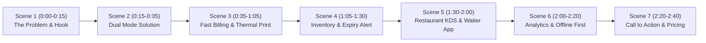

# Upstage POS (Upstage Kadai) — Official Explanation Video Script & Storyboard

> **Project Target**: [Upstage Kadai React Native App](file:///Users/upstage_1/Desktop/Upstagekadai)  
> **Target Audience**: Retail Shop Owners (Kirana, Supermarkets, Departmental Stores) & Restaurant / Cafe Owners in Tamil Nadu & India.  
> **Video Style**: Fast-paced, modern SaaS product walkthrough with conversational Tamil/Tanglish voiceover & English subtitles.  
> **Total Target Duration**: ~2 minutes 20 seconds.

---

## 🎬 Storyboard & Scene-by-Scene Breakdown



---

### 📍 Scene 1: The Hook & Introduction (0:00 – 0:15)
* **Visual on Screen**:
  - Close-up of slow paper bills or bulky expensive POS machines with a red cross (❌).
  - Smooth 3D transition revealing the **Upstage POS** logo and the modern mobile app opening on an iPhone/Android tablet.
  - Floating badge: *"All-in-One Smart Billing for Retail & Restaurant"*.
* **On-Screen Text**:
  - `No Expensive Hardware Needed!`
  - `Turn Any Phone or Tablet into a Smart POS`
* **Voiceover (Conversational Tamil)**:
  > *"வணக்கம்! பில்லிங் மிஷினுக்காக லட்சக்கணக்கில் செலவு பண்ணி அலுத்து போயிட்டீங்களா? இனி கவலையே வேண்டாம்! இதோ உங்களுக்காக — Upstage POS! உங்க சாதாரண மொபைல் அல்லது டேப்லெட் போதும்... உங்க மொத்த கடையையும் விரல் நுனியில் நிர்வகிக்கலாம்!"*
* **Voiceover (English / Tanglish Subtitle)**:
  > *"Tired of spending thousands on bulky billing hardware? Upgrade to Upstage POS! Run your entire retail store or restaurant effortlessly right from your phone or tablet."*

---

### 📍 Scene 2: Dual Mode — Retail & Restaurant in One App (0:15 – 0:35)
* **Visual on Screen**:
  - Screen capture of the **Shop Type Selection / Mode Switcher** ([`restaurantMode.js`](file:///Users/upstage_1/Desktop/Upstagekadai/src/utils/restaurantMode.js)).
  - Tap on **"Retail Store"** ➔ Shows Barcode POS interface.
  - Tap on **"Restaurant"** ➔ Shows Table Grid, Waiter ordering, and Food Categories.
* **On-Screen Text**:
  - `One App. Two Powerful Modes.`
  - `🏪 Retail / Supermarket / Grocery`
  - `🍕 Restaurant / Cafe / Bakery / Dine-In`
* **Voiceover (Conversational Tamil)**:
  > *"Upstage POS-ன் மிகப்பெரிய மேஜிக்கே இந்த 'Dual Mode' தான்! நீங்க மளிகை கடை, சூப்பர் மார்க்கெட், துணிக்கடை நடத்துறவரா இருந்தாலும் சரி... அல்லது உணவகம், கஃபே, பேக்கரி நடத்துறவரா இருந்தாலும் சரி... ஒரே ஆப்பில் உங்களுக்கு தேவையான மோடை செலக்ட் பண்ணி பயன்படுத்திக்கலாம்!"*
* **Voiceover (English / Tanglish Subtitle)**:
  > *"The game-changer with Upstage POS is its Dual-Mode architecture. Whether you run a grocery supermarket or a busy dine-in restaurant, switch workflows in one single tap!"*

---

### 📍 Scene 3: Lightning-Fast Retail Billing & Thermal Printing (0:35 – 1:05)
* **Visual on Screen**:
  - Screen capture of [`SalesScreen.jsx`](file:///Users/upstage_1/Desktop/Upstagekadai/src/screens/SalesScreen.jsx) and [`ScanScreen.jsx`](file:///Users/upstage_1/Desktop/Upstagekadai/src/screens/ScanScreen.jsx).
  - Camera instantly scanning a product barcode (using `react-native-vision-camera`).
  - Item adds to cart instantly with price and tax calculated.
  - Dynamic **UPI QR Code** pops up on screen for GPay/PhonePe scan.
  - Real thermal receipt printer spits out an invoice in 1 second ([`bluetoothPrinter.js`](file:///Users/upstage_1/Desktop/Upstagekadai/src/utils/bluetoothPrinter.js)).
* **On-Screen Text**:
  - `⚡ Instant Barcode Scanning (Camera & Bluetooth Scanners)`
  - `📲 Dynamic UPI QR Code Payments (GPay / PhonePe)`
  - `🖨️ 1-Second Bluetooth Thermal Receipts (58mm / 80mm)`
* **Voiceover (Conversational Tamil)**:
  > *"கஸ்டமர் கூட்டம் அதிகமிருக்கும் போது பில்லிங் ஒருபோதும் லேட் ஆகக்கூடாது! கேமரா மூலமாவோ அல்லது புளூடூத் ஸ்கேனர் மூலமாவோ சில நொடிகளில் பார்கோடு ஸ்கேன் பண்ணி பில் போடுங்க. ஸ்கிரீன்லேயே டைனமிக் UPI QR Code காட்டி பேமெண்ட் வாங்கிடலாம்! அடுத்த செகண்ட் புளூடூத் தெர்மல் பிரிண்டர்ல பில் ரெடி!"*
* **Voiceover (English / Tanglish Subtitle)**:
  > *"Never let rush hours slow you down! Scan barcodes in milliseconds, collect payments instantly via dynamic on-screen UPI QR codes, and print receipts over Bluetooth in a flash!"*

---

### 📍 Scene 4: Smart Inventory & Expired Products Service (1:05 – 1:30)
* **Visual on Screen**:
  - Screen capture of [`InventoryScreen.jsx`](file:///Users/upstage_1/Desktop/Upstagekadai/src/screens/InventoryScreen.jsx) & [`expiredProductsService.js`](file:///Users/upstage_1/Desktop/Upstagekadai/src/utils/expiredProductsService.js).
  - Stock auto-decrementing upon billing.
  - Red alert badge: *"Item Expiring in 3 Days!"*.
  - Yellow badge: *"Low Stock: Only 2 left!"*.
  - HSN Code auto-suggestion dropdown ([`hsnService.js`](file:///Users/upstage_1/Desktop/Upstagekadai/src/services/hsnService.js)).
* **On-Screen Text**:
  - `📦 Real-time Stock Tracking`
  - `⚠️ Low Stock & Expired Product Alerts`
  - `📋 HSN Directory & GST Invoicing`
* **Voiceover (Conversational Tamil)**:
  > *"சரக்கு மேலாண்மை ரொம்ப சுலபம்! ஒவ்வொரு முறை பில் போடும் போதும் ஸ்டாக் ஆட்டோமேட்டிக்கா அப்டேட் ஆகும். பொருள் தீரப்போகுதா? 'Low Stock Alert' செய்திடும். முக்கியமா, எந்த பொருள் காலாவதி ஆகப்போகுதுன்னு முன்கூட்டியே எச்சரிச்சு, நஷ்டத்தை முற்றிலும் தடுத்துடும்!"*
* **Voiceover (English / Tanglish Subtitle)**:
  > *"Inventory management made effortless! Stock updates automatically with each sale. Get instant alerts when items run low, and avoid dead stock with proactive expiry date warnings!"*

---

### 📍 Scene 5: Restaurant Live Ecosystem — Waiter App & Kitchen Display (1:30 – 2:00)
* **Visual on Screen**:
  - Split screen:
    - **Left**: Waiter mobile screen ([`WaiterOrderScreen.jsx`](file:///Users/upstage_1/Desktop/Upstagekadai/src/screens/restaurant/WaiterOrderScreen.jsx)) taking order at Table #4.
    - **Right**: Kitchen tablet ([`KitchenDisplayScreen.jsx`](file:///Users/upstage_1/Desktop/Upstagekadai/src/screens/restaurant/KitchenDisplayScreen.jsx)) immediately receiving the live order with chime sound.
  - Chef taps **"Preparing" ➔ "Served"**.
  - Cashier prints KOT & final table bill in one click ([`RestaurantSalesBilling.jsx`](file:///Users/upstage_1/Desktop/Upstagekadai/src/screens/restaurant/RestaurantSalesBilling.jsx)).
* **On-Screen Text**:
  - `📱 Waiter Mobile Ordering at Customer Table`
  - `👨‍🍳 Live Kitchen Display System (KDS)`
  - `📑 Instant KOT & Table Consolidation`
* **Voiceover (Conversational Tamil)**:
  > *"ஹோட்டல்களுக்கு ஒரு பிரம்மாண்ட வசதி! சப்ளையர்கள் டேபிளிலேயே நின்னு மொபைல் வழியா ஆர்டர் எடுப்பாங்க. அடுத்த நொடியே கிச்சனில் இருக்கும் ஸ்கிரீனுக்கு ஆர்டர் தானா போய் சேர்ந்துடும்! பேப்பர் சீட்டு, கூச்சல் குழப்பம் எதுவுமே கிடையாது! செஃப் ரெடி பண்ணியதும் சிங்கிள் கிளிக்கில் டேபிள் பில்லிங் முடிஞ்சிடும்!"*
* **Voiceover (English / Tanglish Subtitle)**:
  > *"Transform your restaurant floor! Waiters take orders on mobile right at the table, flashing orders instantly onto the Kitchen Display Screen (KDS) for chefs. Zero paper slip confusion, 100% speed!"*

---

### 📍 Scene 6: Business Analytics, Daybook & Offline Peace of Mind (2:00 – 2:20)
* **Visual on Screen**:
  - Screen capture of [`Dashboard.jsx`](file:///Users/upstage_1/Desktop/Upstagekadai/src/screens/Dashboard.jsx) with SVG sales charts and revenue metrics.
  - Expense & Cash management in [`JournalEntry.jsx`](file:///Users/upstage_1/Desktop/Upstagekadai/src/screens/JournalEntry.jsx).
  - Wifi disconnected demo: Offline banner appears ([`OfflineBanner.jsx`](file:///Users/upstage_1/Desktop/Upstagekadai/src/components/OfflineBanner.jsx)), billing continues smoothly, and auto-syncs when online!
* **On-Screen Text**:
  - `📊 Daily & Monthly Sales Analytics & Profit Margins`
  - `📖 Daybook / Journal Entries for Shop Expenses`
  - `🌐 100% Offline Billing with Auto-Cloud Sync`
* **Voiceover (Conversational Tamil)**:
  > *"இன்னைக்கு எவ்வளவு வியாபாரம், எவ்வளவு லாபம், எது டாப் செல்லிங் ஐட்டம் — எல்லாமே அனலிட்டிக்ஸ் சார்ட்டில் கண்கூடா பார்க்கலாம்! தினசரி செலவுகளை 'Journal Daybook'-ல் குறித்து வைக்கலாம். ஒருவேளை நெட் கட் ஆனாலும் பில்லிங் நிற்காது; ஆஃப்லைனிலேயே பில் போட்டுக்கலாம்!"*
* **Voiceover (English / Tanglish Subtitle)**:
  > *"Track daily sales, net profits, and top-moving products in clean analytics dashboards. Log day-to-day store expenses in the daybook, and enjoy uninterrupted offline billing even when the internet drops!"*

---

### 📍 Scene 7: Multi-Staff Access & Call to Action (2:20 – 2:40)
* **Visual on Screen**:
  - Staff Roles screen ([`StaffCreation.jsx`](file:///Users/upstage_1/Desktop/Upstagekadai/src/screens/StaffCreation.jsx) & [`StaffLogin.jsx`](file:///Users/upstage_1/Desktop/Upstagekadai/src/screens/StaffLogin.jsx)) showing Admin, Cashier, Waiter, and Kitchen logins.
  - End screen with **Upstage POS App Logo**, download badges for Android & iOS, website / WhatsApp contact info.
* **On-Screen Text**:
  - `👥 Secure Roles: Admin • Cashier • Waiter • Kitchen`
  - `⭐ 14-Day Free Trial Available`
  - `📲 Call / WhatsApp: +91 XXXXXXXXXX`
  - `🌐 www.upstagepos.com`
* **Voiceover (Conversational Tamil)**:
  > *"அட்மின், கேஷியர், வெயிட்டர், கிச்சன் என அனைவருக்கும் தனித்தனி பாதுகாப்பான லாகின் வசதி! உங்க கடையை இன்றே நவீன டிஜிட்டல் கடையாக மாற்றுங்கள்! 14 நாட்கள் இலவச ட்ரையல் பெற உடனே எங்களை தொடர்பு கொள்ளுங்க அல்லது ஆப்பை டவுன்லோட் பண்ணுங்க!"*
* **Voiceover (English / Tanglish Subtitle)**:
  > *"Role-based logins for Admin, Cashier, Waiter, and Kitchen staff. Empower your store today with Upstage POS! Contact us now for your 14-day free trial or live demo!"*

---

## 🛠️ How to Create the Final Video (3 Simple Ways)

### Option 1: Use the Interactive Video Presentation Player (Instant!)
You already have the full interactive player created in:
`file:///Users/upstage_1/Desktop/Upstagekadai/UpstagePOS_Explanation_Video.html`
1. Double-click and open it in Safari or Google Chrome.
2. Hit **"Play"** or select any scene.
3. It plays animated mobile mockups, bullet points, voice narration in Tamil/English, and subtitles!
4. Use **Cmd + Shift + 5** on your Mac to screen record it with high definition in minutes!

### Option 2: Record Real Simulator Screencasts
1. Open terminal and run:
   ```bash
   cd /Users/upstage_1/Desktop/Upstagekadai
   npm run ios
   # OR
   npm run android
   ```
2. Open **QuickTime Player** ➔ **File** ➔ **New Screen Recording**.
3. Follow the 7 scenes above in order:
   - Screen 1: Login & Welcome
   - Screen 2: Mode Toggle (Retail vs Restaurant)
   - Screen 3: Billing screen + Scan item + Print button
   - Screen 4: Inventory screen + Expiry alerts
   - Screen 5: Waiter screen & Kitchen Display (KDS)
   - Screen 6: Dashboard analytics & Charts
4. Drop the screen recordings into **CapCut** (Mac app or web) or **Canva**.
5. Read or paste the Tamil voiceover script provided above.

### Option 3: Short Social Media Formats (Reels / Shorts - 30s & 60s)
- **30-Second Kirana Reel**:
  - *Hook (0-5s)*: "இன்னும் பில்லிங் மெஷினுக்கு ₹30,000 செலவு பண்றீங்களா?"
  - *Solution (5-20s)*: "உங்க மொபைல்ல Upstage POS இன்ஸ்டால் பண்ணுங்க. பார்கோடு ஸ்கேன், UPI QR பேமெண்ட், புளூடூத் பிரிண்டிங் எல்லாமே ஒரே நொடியில்!"
  - *CTA (20-30s)*: "இன்றே இலவசமாக தொடங்குங்கள். Link in Bio!"
- **30-Second Restaurant Reel**:
  - *Hook (0-5s)*: "ரெஸ்டாரண்ட்ல சர்வர்க்கும் கிச்சனுக்கும் ஆர்டர் குழப்பமா?"
  - *Solution (5-20s)*: "Upstage POS Waiter App & Live Kitchen Display (KDS) பயன்படுத்துங்க. டேபிள் ஆர்டர் அடுத்த செகண்ட் கிச்சன்ல காட்டும்!"
  - *CTA (20-30s)*: "DM for free demo today!"
